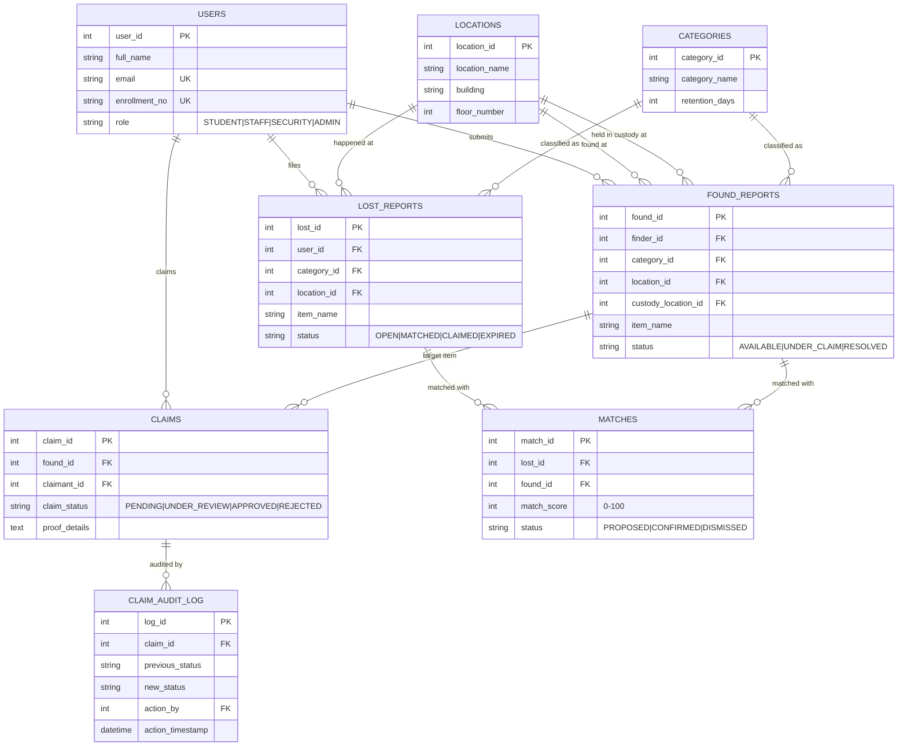

# Campus Lost & Found Recovery and Claim Verification System

[](https://www.mysql.com/)
[](https://nodejs.org/)
[](https://expressjs.com/)
[](DESIGN.md)
[](#)

* **Department:** Umaer Basha Institute of Information Technology (UBIT)
* **University:** University of Karachi
* **Course:** Database Management Systems (DBMS) — 4th Semester
* **Academic Submission:** September 2026

---

## 👥 Project Team & Contributors

| Name | Seat / Enrollment Number | Role |
| :--- | :---: | :--- |
| **Syed Umer Hashmi** | `EB25210006105` | Full-Stack Architect, Clay UI System & Lead Developer |
| **Maaz Malick** | `EB25210006036` | 3NF Schema Normalization & Concurrency Locking Specialist |
| **Muzammil Rizwan** | `EB25210006079` | Stored Procedures, Matching Algorithms & Analytics Specialist |
| **Adan Kamran** | `EB25210006085` | Frontend UI Integration, Verification & Quality Assurance |

---

## 📌 Executive Overview

The **Campus Lost & Found Recovery System** is a normalized relational database application engineered specifically for university campuses. It replaces inefficient physical noticeboards and WhatsApp lost-and-found groups with an automated, ACID-compliant verification platform that matches misplaced items, enforces pessimistic row-locking to prevent concurrent claim race conditions, generates printable official custody vouchers, and provides spatial security intelligence via SQL Views.

### 🌟 Core Academic DBMS Highlights
1. **Third Normal Form (3NF) Relational Architecture:** 8 fully normalized tables with referential integrity constraints, avoiding insertion, update, and deletion anomalies.
2. **Pessimistic Concurrency Control (`SELECT ... FOR UPDATE`):** Prevents double-claim race conditions at the InnoDB storage engine level when multiple students attempt to claim the same found item simultaneously.
3. **Automated 4-Factor Stored Procedure Matching:** Evaluates Category (40%), Location (25%), Temporal Proximity (25%), and Brand/Color (10%) to compute match scores (0–100%).
4. **Autonomous Database Triggers:** Watches claim lifecycle events to produce an immutable, tamper-proof audit trail (`claim_audit_log`).
5. **Real-time Analytical Views:** Aggregates departmental recovery rates and campus loss hotspots (Labs, Library, Canteen).
6. **Clay Design System UI:** Tactile, warm-cream aesthetic (`#fffaf0`) featuring interactive score explainers, live concurrency test split-screen, and printable custody handover vouchers.

---

## 🏗️ System Architecture

```text
┌────────────────────────────────────────────────────────────────────────┐
│                          CLAY DESIGN SYSTEM UI                         │
│        (Warm cream canvas, tactile cards, responsive navigation)       │
└───────────────────────────────────┬────────────────────────────────────┘
                                    │ HTTP REST / JSON
┌───────────────────────────────────▼────────────────────────────────────┐
│                       EXPRESS.JS BACKEND API                           │
│     (Connection Pool via mysql2/promise, Port 3000, CORS enabled)      │
└───────────────────────────────────┬────────────────────────────────────┘
                                    │ SQL Queries, Procedures, Views
┌───────────────────────────────────▼────────────────────────────────────┐
│                    MYSQL 8.0 RELATIONAL DATABASE                       │
│  8 Tables (3NF) | InnoDB Row Locks | ACID Transactions | Event Triggers │
└────────────────────────────────────────────────────────────────────────┘
```

---

## 🗄️ Relational Database Schema (3NF)



---

## 🚀 Getting Started

### 1. Prerequisites
* **Node.js:** v18.0 or v24.x LTS ([Download](https://nodejs.org/))
* **Git for Windows:** ([Download](https://git-scm.com/))
* **MySQL Community Server 8.0+:** Running locally on port `3306` ([Download](https://dev.mysql.com/downloads/installer/))

### 2. Database Setup
Launch PowerShell as Administrator and run the automated deployment script:
```powershell
cd database
powershell -ExecutionPolicy Bypass -File .\setup_database.ps1
cd ..
```
*Default root password is set to `admin123` in `.env.example` and `src/config/db.js`.*

### 3. Install Dependencies & Start Server
```powershell
npm install
npm run dev
```

### 4. Open Application
Navigate to `http://localhost:3000` in any web browser.

---

## 🧪 Live Concurrency Demonstration

To test MySQL ACID row locking in real time:
1. Open the web interface at `http://localhost:3000`.
2. Click **⚡ Test Concurrency Lock** in the top navigation bar.
3. Click **🚀 Re-Run Concurrent Race**.
4. Observe the split-screen execution:
   * **Thread A (Maaz Malick):** Wins `SELECT ... FOR UPDATE` lock $\rightarrow$ `200 OK` (Committed to `UNDER_CLAIM`).
   * **Thread B (Muzammil Rizwan):** Blocked by InnoDB row lock $\rightarrow$ `409 Conflict` (Safely aborted, double-claim prevented).

---

## 📚 Project Documentation

* 📖 **[Viva Defense Guide](docs/VIVA_PREP.md):** Complete answers to top 10 examiner questions & live presentation script.
* 📋 **[Product Requirements Document (PRD)](docs/PRD.md):** Detailed functional & non-functional requirements.
* 📐 **[System Design & 3NF Proofs](docs/design.md):** Normalization proofs, functional dependencies, and ER diagrams.
* 🔌 **[REST API Specification](docs/API.md):** Complete endpoints, request/response JSON contracts.
* 🎨 **[Clay Design System](DESIGN.md):** Typography, color tokens, and layout guidelines.
* ✅ **[Task Checklist](docs/TASKS.md):** Progress tracking from Phase 1 through Phase 5.
