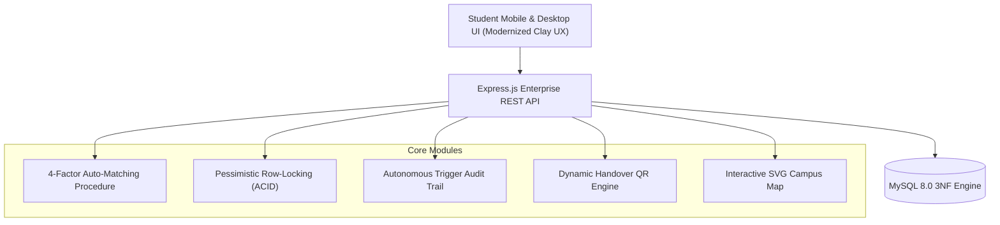

# Campus-Scale Official Deployment Blueprint
## UBIT Lost & Found Recovery System — Roadmap & Architectural Strategy

* **Prepared for:** Syed Umer Hashmi (`EB25210006105`), Maaz Malick (`EB25210006036`), Muzammil Rizwan (`EB25210006079`)
* **Department:** Umaer Basha Institute of Information Technology (UBIT), University of Karachi
* **Target Objective:** Transition from an academic semester prototype to an **official, department-wide, production-grade campus platform**.

---

## 1. Executive Vision: Making It the Official Campus App

To get this app officially adopted by the UBIT Department Chairman, Administration, and Campus Security, the system must solve real physical campus constraints:
1. **Mobile-First Reality:** 95% of students and guards access this on their smartphones across campus grounds.
2. **Chain of Custody & Accountability:** Guards need to prove *who* handed in an item, *where* it is physically stored, and *who* collected it without messy physical paper registers.
3. **Institutional Identity:** Official UBIT / University of Karachi branding, real department floor plans, and integration with student enrollment formats.

---

## 2. Critical UI / UX Overhaul Plan (Tomorrow's Agenda)

The current UI was built as an academic testing prototype. To look and feel like an enterprise-grade university product, we will rebuild the UX around modern design principles:

### A. Information Architecture & Layout
* **App Shell Layout:** Replace heavy horizontal tables with responsive **Masonry & Grid Cards** that collapse cleanly on mobile.
* **Sticky Mobile Bottom Navigation:** Quick thumbs-reach navigation for students:
  * `🏠 Feed` · `🔍 Report Lost` · `📦 Report Found` · `📋 My Claims` · `👤 Profile`
* **Desktop Split-View:** Left panel list with live instant search & filters; right panel detailed preview card with photo and verification history.
* **Stepped Filing Wizard (3-Step Flow):**
  * *Step 1 (Item Identity):* Category, Item Name, Brand, Distinctive Marks (scratches, stickers).
  * *Step 2 (Location & Time):* Interactive Floor Plan pin drop, Date/Time picker.
  * *Step 3 (Proof & Photo):* Photo upload, secret verification question (e.g. *"What is the phone's lock-screen wallpaper?"*).

### B. Visual Polish & Branding
* **Official UBIT Palette:** Harmonize the warm cream canvas with official UBIT Emerald Green (`#0A5C36`), Deep Forest Slate (`#0B2B1B`), and Campus Gold Accent (`#D4AF37`).
* **Department Assets Integration:**
  * Official UBIT Crest & University of Karachi Seal in the header and vouchers.
  * Real interactive department vector map (Ground Floor Labs vs. 1st Floor Classrooms).
* **Tactile Polish:**
  * Skeleton loading states while database queries execute.
  * Dynamic micro-badges for match confidence ($90\%+$ in vibrant green pill).
  * High-contrast accessibility for outdoor sunlight readability.

---

## 3. High-Value Campus Features to Introduce

Here is the strategic breakdown of features that will make UBIT administration and faculty say: *"We need this running across the entire department immediately."*

### Feature 1: Student Card Quick-Lookup & Instant Notification
* **The Campus Problem:** Student ID cards (RFID/Green cards) are the single most frequently misplaced item in labs and the library.
* **The Solution:**
  * A dedicated **"Scan / Enter Student ID"** shortcut.
  * The finder inputs the enrollment number (e.g., `EB25210006105`).
  * The database performs an instant foreign key lookup and sends an automated notification (Email / SMS / WhatsApp webhook) saying:
    > *"Your lost UBIT Student Card was submitted to Software Lab 1 Desk. Collect it before 4:00 PM."*

### Feature 2: Digital QR-Code Custody Handover (Zero-Paper Protocol)
* **The Campus Problem:** Physical registers get lost, handwriting is illegible, and guards have no way to verify if the student is genuine.
* **The Solution:**
  * Once Officer Farhan approves a claim in the system, the student's app generates a secure, one-time **Encrypted Handover QR Code** valid for 48 hours.
  * The student walks up to the security booth.
  * The guard points their smartphone camera at the student's phone screen.
  * The QR code automatically triggers an authenticated API call that locks the database record as `RESOLVED`, timestamps the exact second, and logs the guard's user ID.

### Feature 3: Physical Storage Bin & Shelf Location Tracking
* **The Campus Problem:** Security guards take custody of 50+ items and lose track of which drawer or cabinet an item is kept in.
* **The Solution:**
  * Add a `storage_bin` column to `found_reports` (e.g., `Bin B-12, Cabinet 3, Lab Attendant Desk`).
  * When a claim is approved, the security screen tells the guard exactly where to reach to hand over the physical property without searching drawers.

### Feature 4: Interactive Department Multi-Floor Map (SVG Pin Drop)
* **The Campus Problem:** Generic location dropdowns don't capture where within a large hall an item was dropped.
* **The Solution:**
  * Tomorrow when you bring the real department blueprint, we will convert it into an interactive SVG floor plan:
    * **Ground Floor:** Hardware Lab, Software Lab 1, Software Lab 2, Networks Lab, Chairman Office, Main Canteen.
    * **1st Floor:** Lecture Theatres 1–6, Seminar Library, Faculty Rooms, Server Room.
  * Students can tap directly on the map to place a pin where they last had their item.
  * Generates an incident density heatmap (highlighting problem areas for campus security patrols).

### Feature 5: Secret Verification Challenge (Anti-Fraud Proof)
* **The Campus Problem:** Anyone seeing a found iPhone listed can try to claim it by guessing basic details.
* **The Solution:**
  * When a finder reports an item, they can enter a **Secret Question** only the true owner knows:
    * *Example:* *"What sticker is on the back of the laptop?"* or *"What is the lockscreen wallpaper?"* or *"What are the first 3 digits of the serial number?"*
  * The claimant must answer this challenge. The system or guard compares the answers blindly before physical release.

### Feature 6: Good Samaritan "Campus Honor Roll" & Karma Points
* **The Campus Problem:** Many students don't bother turning in found items because there is no incentive.
* **The Solution:**
  * Award students "UBIT Civic Karma Points" every time an item they turned in is successfully reunited with its owner.
  * Top students appear on the monthly **Campus Honor Roll** dashboard.
  * The department can issue official Letters of Appreciation at the end of the semester.

### Feature 7: Automated 90-Day Unclaimed Auction / Charity Lifecycle
* **The Campus Problem:** Unclaimed items pile up in security lockers for years.
* **The Solution:**
  * Database event trigger automatically monitors `found_reports.found_date`.
  * After 60 days: Status updates to `AUCTION_WARNING`.
  * After 90 days: Status updates to `ELIGIBLE_FOR_CHARITY_OR_DISPOSAL`.
  * Generates an official report for the Department Chairman to sign off on donations to student welfare funds.

---

## 4. Tomorrow's Department Visit Checklist

When you visit UBIT tomorrow, collect the following materials so we can integrate them immediately:
1. **Department Blueprint / Floor Plan:**
   * Take a clear photo or get a PDF/handout of the UBIT building layout (labs, classrooms, library, cafeteria, stairs).
2. **Official Crest & Logos:**
   * High-resolution PNG of the UBIT emblem and University of Karachi logo.
3. **Exact Room / Lab Designations:**
   * List of official lab names and designations (e.g. *Lab 1 - Turing Hall, Lab 2 - Hopper Lab, Seminar Library, Student Affairs*).
4. **Current Manual Protocol:**
   * Ask the lab attendants or guards where found items currently go and what register they write them in. We will digitize their exact workflow.

---

## 5. Proposed Next-Phase Architecture Upgrade

Everything is preserved in `context.md` and `docs/TASKS.md`. Tomorrow we will take this from a 100% complete academic prototype to an official campus deployment!
