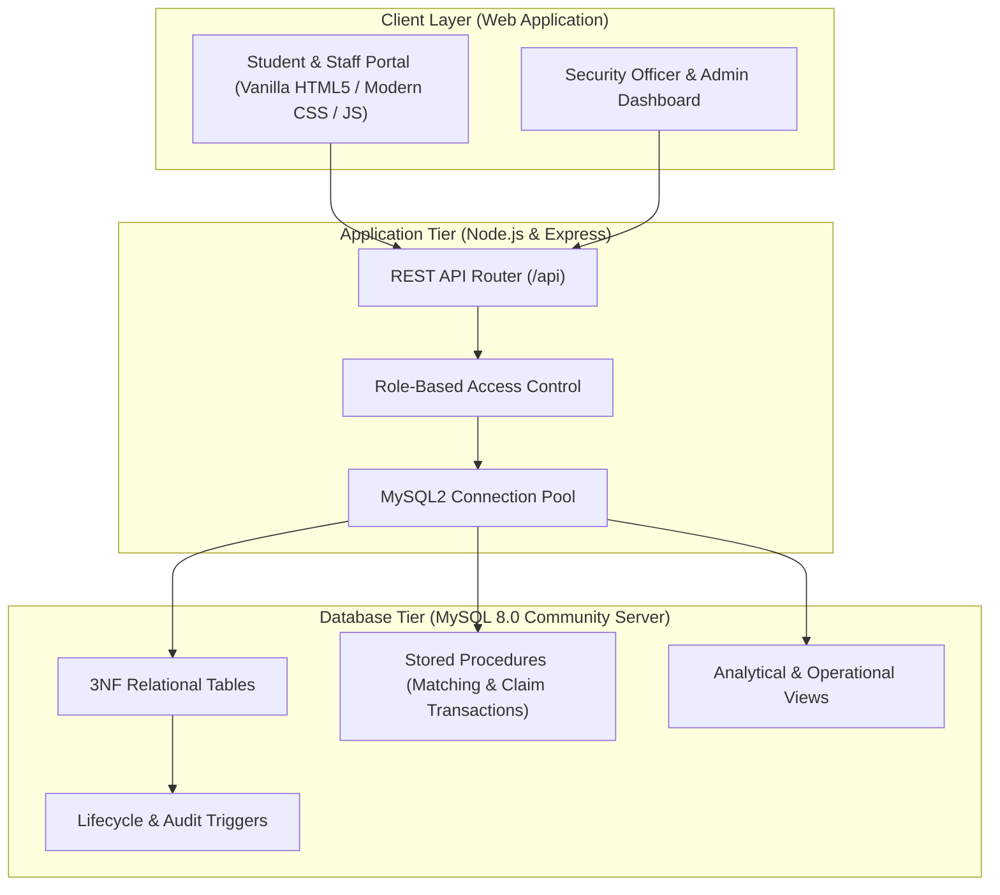
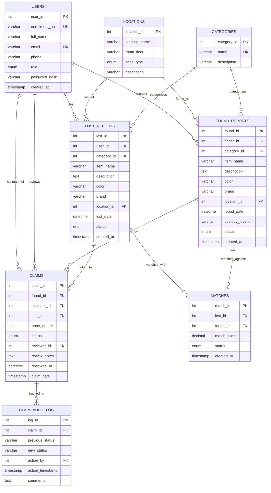
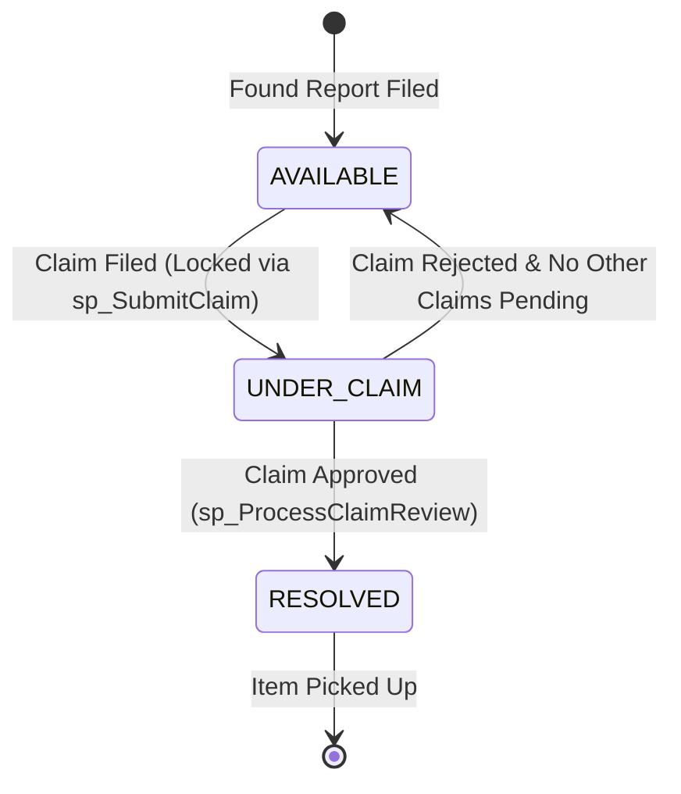

# System Architecture & Database Design Specification

## Project Title
**Campus Lost & Found Recovery and Claim Verification System**  
**Institution:** Umaer Basha Institute of Information Technology (UBIT), University of Karachi  
**Course:** Database Management Systems (DBMS) — 4th Semester  

---

## 1. High-Level System Architecture



---

## 2. Relational Schema & Normalization Proofs (3NF)

A central evaluation requirement for a university DBMS project is demonstrating that the relational model is in **Third Normal Form (3NF)** to avoid update, insertion, and deletion anomalies.

### 2.1 First Normal Form (1NF)
* **Definition:** A relation is in 1NF if and only if all underlying domains contain only atomic (indivisible) values, and there are no repeating groups.
* **Application in our schema:**
  * All multi-attribute entities are decomposed into atomic attributes (e.g., separating `building_name` and `room_floor`, and splitting location strings from item descriptions).
  * No comma-separated lists of tags or claims; each claim and match is an individual atomic tuple.
  * Every table has an explicit, unique Primary Key (`user_id`, `location_id`, `category_id`, `lost_id`, `found_id`, `match_id`, `claim_id`, `log_id`).

### 2.2 Second Normal Form (2NF)
* **Definition:** A relation is in 2NF if it is in 1NF and every non-prime attribute is fully functionally dependent on the entire primary key (no partial dependencies on composite keys).
* **Application in our schema:**
  * In the `matches` table, the primary key is a surrogate `match_id`, with a unique candidate key `(lost_id, found_id)`. Non-key attributes like `match_score`, `status`, and `created_at` depend on the *entire* pairing, not on `lost_id` or `found_id` individually.
  * Category names and descriptions depend solely on `category_id` (not mixed inside `lost_reports`).
  * Location details depend solely on `location_id` (not repeated inside `found_reports`).

### 2.3 Third Normal Form (3NF)
* **Definition:** A relation is in 3NF if it is in 2NF and there are no transitive dependencies (i.e., non-prime attributes must depend solely on the primary key: $X \rightarrow Y$ where $X$ is a superkey).
* **Application in our schema:**
  * In `lost_reports`, we do **not** store the user's name, email, or department. Instead, we only store foreign key `user_id`. Storing `user_name` or `phone` in `lost_reports` would create a transitive dependency: `lost_id -> user_id -> user_name`.
  * Similarly, in `found_reports`, we do not store building details; we link `location_id`, preventing `found_id -> location_id -> building_name`.
  * **Result:** Zero data redundancy, elimination of modification anomalies, and strict referential integrity.

---

## 3. Entity-Relationship (ER) Model



---

## 4. Concurrency Control & ACID Locking Model

### 4.1 The Race Condition Problem
In a campus lost and found system, high-value items (smartphones, wallets, laptops) may attract multiple simultaneous claims. If two students submit a claim at the exact same millisecond:
1. Without concurrency control, both requests read `status = 'AVAILABLE'`.
2. Both proceed to create conflicting claims.
3. If an officer verifies one, the other student might simultaneously be processed, resulting in conflicting double-handover records.

### 4.2 Pessimistic Row-Level Locking (`SELECT ... FOR UPDATE`)
We use MySQL's InnoDB engine with explicit row locks in `sp_SubmitClaim` and `sp_ProcessClaimReview`:

```sql
START TRANSACTION;

-- Acquires an exclusive write lock (X-lock) on the found_reports row
SELECT status INTO v_item_status
FROM found_reports
WHERE found_id = p_found_id
FOR UPDATE;

-- Any concurrent transaction attempting to read or modify this row is blocked
-- until this transaction issues COMMIT or ROLLBACK.
...
COMMIT;
```

### 4.3 Transaction State Transition Lifecycle



---

## 5. Automated Matching Algorithm

The stored procedure `sp_GenerateMatchesForLostReport` executes the following scoring formula:

$$\text{Total Score} = W_{\text{category}} + W_{\text{location}} + W_{\text{date}} + W_{\text{attribute}}$$

Where:
* **$W_{\text{category}}$ (40 points):** Binary exact match between `lost_reports.category_id` and `found_reports.category_id`.
* **$W_{\text{location}}$ (25 points):**
  * Exact Room/Location match: **25 points**
  * Same Building match: **15 points**
  * Different Building: **0 points**
* **$W_{\text{date}}$ (25 points):** Proximity between `lost_date` and `found_date`:
  * $|\Delta t| \le 24$ hours: **25 points**
  * $|\Delta t| \le 3$ days: **18 points**
  * $|\Delta t| \le 7$ days: **10 points**
* **$W_{\text{attribute}}$ (10 points):** Case-insensitive match on `color` or `brand`.
* **Thresholds:**
  * Score $\ge 40\%$: Stored in `matches` table as `PROPOSED`.
  * Score $\ge 60\%$: Lost report status updated to `MATCHED`.

---

## 6. Triggers & Views Specification

### 6.1 Triggers
1. **`trg_after_claim_insert`**: Automatically creates the root audit log entry upon claim creation.
2. **`trg_after_claim_status_update`**: Detects status transitions (`PENDING` $\rightarrow$ `UNDER_REVIEW` $\rightarrow$ `APPROVED`/`REJECTED`) and writes to `claim_audit_log` with timestamp and officer ID.
3. **`trg_after_lost_report_cancelled`**: Sets all pending match proposals to `DISMISSED` when an owner cancels their lost report.

### 6.2 Views
1. **`vw_campus_recovery_rate`**: Calculates recovered item count / total lost count per category.
2. **`vw_location_hotspots`**: Aggregates incident counts per building and zone to highlight campus security risk areas.
3. **`vw_security_claims_queue`**: Denormalized operational view joining claimant, item, custody location, and match score for fast security officer review.
4. **`vw_active_match_feed`**: Live match suggestions feed for student users.
